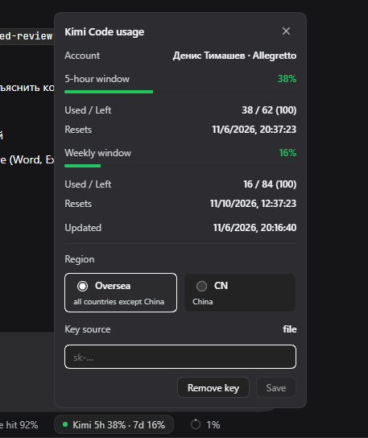

# dsh-kimi-coding-usage

A [DeepSeek Harness](https://github.com/deepseek-ai/deepseek-harness) plugin that shows your **Kimi Code** subscription quota right in the Web UI:

<p align="center">
  
</p>


- a compact badge below the message composer: `Kimi 5h 28% · 7d 12%`, color-coded (green → yellow → red as usage grows);
- a click popover with progress bars, used/remaining counts, reset times (24-hour format), and your account level;
- API key management in the same popover — the key is stored in the Harness credential store, not in plain-text config;
- region switch: **Oversea** (`api.kimi.ai/coding`) or **CN** (`api.kimi.com/coding`).

> This targets the **Kimi Code** membership API (`api.kimi.ai/coding` / `api.kimi.com/coding`), not the pay-as-you-go developer platform (`api.moonshot.ai`). Keys look like `sk-kimi-…` and are created in the [Kimi Code Console](https://www.kimi.com/code/console).

## Install

In DeepSeek Harness: **Settings → Plugins → Install bundle**, or ask the agent:

```
Install the bundle dsh-kimi-code-usage
```

Directly from GitHub without npm:

```
Install the bundle github:ancientbag/dsh-kimi-code-usage 
```

⚠️ If the badge with Kimi coding usage did not appear -> Try to relaunch Deepseek Harness.

Then click the badge below the composer, paste your API key, and save.

## Configuration

Row config in `cordis.patch.yml` (all optional):

| Field | Default | Meaning |
|---|---|---|
| `apiKey` | `""` | Kimi Code API key. Prefer the popover — it stores the key as the `MOONSHOT_API_KEY` credential. |
| `baseUrl` | `https://api.kimi.ai/coding` | Use `https://api.kimi.com/coding` for China accounts. Also switchable in the popover. |
| `cacheSeconds` | `60` | Hard debounce: at most one upstream request per interval, however often the UI asks. Minimum 30. |

Key precedence: `config.apiKey` → credential store / launch environment / `.env` (`MOONSHOT_API_KEY`).

## How it works

- Host half (`index.js`) registers an authenticated `/api/kimi.balance` route via `ctx.connection.fetch`, proxies `GET {baseUrl}/v1/usages` and `/v1/me`, and debounces upstream calls.
- Client half (`client.js`) renders the badge into the `conversation.composer.dock` slot and the popover into `shell.overlay`, polling the local route once a minute and on every badge click.

## License

MIT
